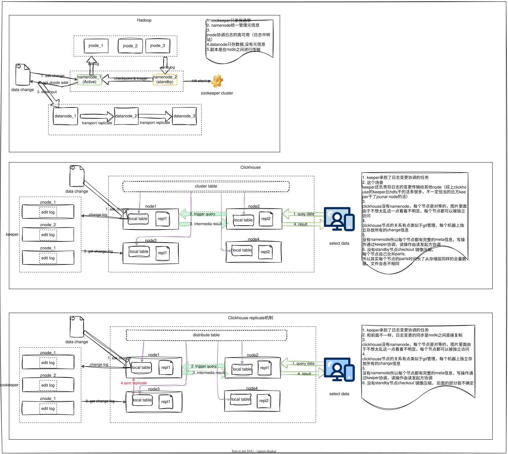

## 起因
大概在2018年注意到了clickhouse，买了一本书，开了个头了解了"列式存储"、"查询很快"、"适合宽表"这几个关键词，后面由于惰性搁置了,这次刚好能够综合整理，所以优先看clickhouse。
## 基础
* 存储
  * 列式存储
    * 数据类型统一，使得压缩效率更高
    * 数据块的连续性，有利于快速接入向量化运算
  * 层级
    * parts内部有序存储：读取更快，这个区别于非有序存储(比如hive/spark运算)
    * 后台任务定期将将较小的parts合并成较大的parts，默认最大parts 150GB
```   
    --分区
      -- parts
        -- 索引（粒度）
```
* min-max索引
  * 记录每个块排序键对应的最大值和最小值，数据搜索的时候根据块的min-max信息只加载可能存在数据的块到内存里
* 稀疏索引
  * 特征
    * 先决条件：每个parts数据按照排序键有序存储
    * 数据存储区块：parts块内按照粒度构建索引,默认每个粒度8192行数据
    * 索引：只存每个粒度第一行数据的排序键值
  * 优势
    * 稀疏索引能够减少索引的存储占用，并且能够快速定位到对应的粒度区间
* 分区
  * 分区和hive的思路是一致的，并且不同分区的parts是独立的
  * 注意：分区不都是好的，会增加parts文件数，如果业务中需要频繁的不带分区条件查询，反而会增加文件读取次数
* 并行运算（查询）
  * clickhouse为速度而打造，执行查询高度并行
  * 并行策略
    * 多分片并行：按照CPU内核数并行
    * 多服务器并行：每个字节点进行完成
* 向量化运算
## 分布式
```
在大脑里面已经植入了hadoop分布式解决方案的情况下，clickhouse分布式解决方案会有点困惑，这一块花了相对多一些的时间。
```
### 写数据
* keeper: clickhouse用C++实现的zookeeper，[clickhouse提供了converter工具](https://private-7c7dfe99.mintlify.site/docs/zh/guides/oss/deployment-and-scaling/keeper)
  * 协调者：跟踪replica完成状态、跟踪各节点数据在哪块parts上、主replica选举、协调schema全部节点变更、监测shards健康状态
  * 节点宕机数据恢复
* node节点
  * 和hdfs完全不同，node没有namenode/jounalnode/datannode这些，只有shard的概念
  * 每个节点几乎是具备相同地位的，可以同时访问
  * 写数据从被访问节点开始->数据根据分片规则进行路由转发->副本节点通过keeper
### 读数据
* keeper: 读数据一般不会用到keeper组建
* 接收到查询请求的node,根据负载均衡策略和副本状态，直接将查询请求路由到对一个的shard,并且收集所有的查询，并且完成最后的汇总
### 不恰当的类比
* keeper: keeper承担了hdfs的选举能力+JournalNode的日志HA能力
* node/shard节点各节点关系更类似于git的分布式管理，去中心化，很平等
## 特征
* Engine
  * MergeTree,ReplaceMergeTree（去重、区别于传统的LST直接落盘）,AggregatingMergeTree(隐藏着avg的增量算法-存储[avg,count])
    * 区别于传统的LST
      * LST: 变更先写变更日志
      * MergeTree:直接落盘，最典型的是ReplaceMergeTree
  * 有趣的engine=null表
* [物化视图](https://clickhouse.com/docs/zh/concepts/features/materialized-views/incremental-materialized-view)
  * 本质是个触发器+物理表
  * 新增数据时会触发视图对应的table数据更新
  * 丰富的解决方案（null技巧），base在这个特征下面可以对宽表做一个完整的数据分析场景
    * 问题：一张普通表挂多少物化视图合理？
  * 与传统
* [投影](https://clickhouse.com/docs/zh/concepts/features/projections/projections)
  * 隐藏物理表
* [投影vs物化视图](https://clickhouse.com/docs/zh/concepts/features/projections/projections)
  * 投影是嵌入在表的，对于使用的人来说是无感知的（意味着不支持join）
  * 物化视图，需要用新的表承接，需要维护新的schema。使用的人需要了解schema的基本信息
  * 同步and异步：写数据时投影的写入时异步的，可能会存在查出的数据不是最新数据状态的问题，物化视图是同步的，但是ReplacingMergeTree也会存在历史数据的问题?
## 多模态存储和向量化搜索

## 接口

## 源码快速浏览

## 最佳实践

## 思考与自我解答
* 性能优化
  * 空间换时间，在clickhouse里面有哪些时空转换的点？
    * 投影/物化视图都是用空间换时间的解决方案，但列式存储以及背后的压缩能够缓解磁盘空间问题
    * 压缩存储属于时间换空间
    * 
  * 顺序存储
    * 存储有序牺牲了写入的便利性，换取读取的高效能力
* 性能优化很多时候也是
* 一张普通表最多挂多少物化视图合理？
* 级联物化视图最多支持几层级联？
* clickhouse功能上的冗余且不相通，这个似乎有点反直觉
* like关键词
* 分布式不同节点存储的相同范围的数据，底层的文件应该是不同的
  * 原因：数据同步的时候各机器独立运行parts的合并
  * 坏处：没有办法通过类似于md5这样的文件工具快速检查replicate是否一致
* 增加节点，数据再平衡过程是什么样的
* 看clickhouse
* 后台进程的可观测性
* keeper的宕即恢复
* clickhouse多套语义体系
  * 部署不同的语义
    * 分布式
    * 单机
  * 查询function不同语义
    * avg/avgState
    * [左侧的菜单有相关list](https://private-7c7dfe99.mintlify.site/docs/zh/guides/clickhouse/examples/aggregate-function-combinators/avgState)
  * 不同语义意味着迁移成本
* 遗留问题
  * 分布式表分片的规则是怎么做的？
  * shard主从选举过程？
  * keeper和节点的通信在各业务场景下谁主动？
  * clickhouse也支持udf这个要看看，另外不知道是否支持udfa以及增量分布式的增量扩展
## 有趣的感悟
* clickhouse获取到了不曾了解的解决方案
  * 物化视图的解决方案
    * null方案：虽然可能可以用语法糖替代，但依然很欣赏这个解决方案
    * 物化视图其实有点类似于pipeline(不知道比喻恰当不)，级联的解决方案相当有趣，但会不会影响写入速度？毕竟物化视图是写入同步的。
    * 增量机制很巧妙
  * 投影
    * 和传统关系型数据库索引解决差别极大
      * order by的投影会多出额外一倍的存储空间(二级索引式的空间占用会好很多)
      * 投影支持group by
      * 支持自定义组合运算的排序
* 由于收获了不一样的解决方案而心生愉悦：这种喜悦并非一句“列式存储可以节省存储空间优化查询性能”这么空洞的描述带来的。
* 自身的思考
  * 我总是以悲观的方式去看待一个解决方案，比如clickhouse投影和物化视图功能的重叠，我总担心一致性的管理，再比如cluster和local有两套表名，我总担心在应用过程中写错了表名导致测试通过，但实际有问题。这些悲观会让我在看这些解决方案的时候各种顾虑，然后也会在细节里面越陷越深。其实这世界上永远没有完美的方案，这甚至可能是AI时代，人类的生存逻辑（话题有点大了）

## clickhouse和hdfs高可用的比较


## 附录
 - [clickhouse架构](https://clickhouse.com/docs/zh/concepts/core-concepts/academic-overview#page-12-6)
 - 
