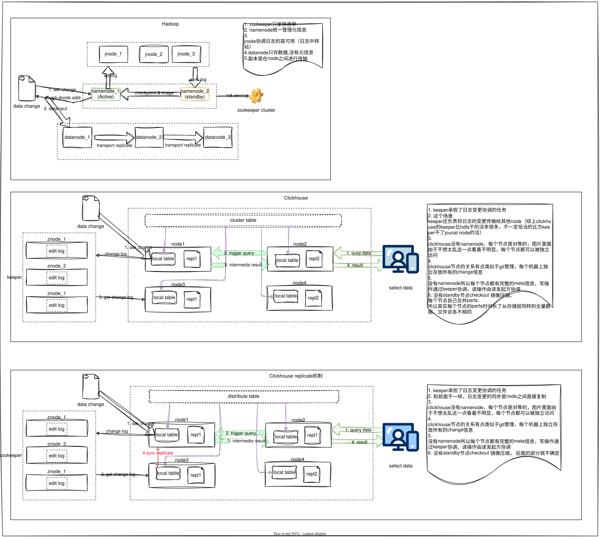

## 起因
大概在2018年注意到了clickhouse，买了一本书，开了个头了解了"列式存储"、"查询很快"、"适合宽表"这几个关键词，后面由于惰性搁置了,这次刚好能够综合整理，所以优先看clickhouse。
## 基础
* 存储
  * 列式存储
    * 数据类型统一，使得压缩效率更高
    * 数据块的连续性，有利于快速接入向量化运算
  * 层级
    * parts内部有序存储：读取更快，这个区别于非有序存储(比如hive/spark运算)
    * 后台任务定期将将较小的parts合并成较大的parts，默认最大parts 150GB
```   
    --分区
      -- parts
        -- 索引（粒度）
```
* 索引
  * 稀疏索引
    * 特征
      * 先决条件：每个parts数据按照排序键有序存储
      * 数据存储区块：parts块内按照粒度构建索引,默认每个粒度8192行数据
      * 索引：只存每个粒度第一行数据的排序键值
    * 优势
      * 稀疏索引能够减少索引的存储占用，并且能够快速定位到对应的粒度区间
  * 跳数索引
    * min-max索引
      * 记录每个块排序键对应的最大值和最小值，数据搜索的时候根据块的min-max信息只加载可能存在数据的块到内存里
    * 跳数索引还包括布隆索引、set索引
* 分区
  * 分区和hive的思路是一致的，并且不同分区的parts是独立的
  * 注意：分区不都是好的，会增加parts文件数，如果业务中需要频繁的不带分区条件查询，反而会增加文件读取次数
* 并行运算（查询）
  * clickhouse为速度而打造，执行查询高度并行
  * 并行策略
    * 多分片并行：按照CPU内核数并行
    * 多服务器并行：每个节点并行计算，结果由发起的节点汇总
## 向量化运算

## 分布式
```
在大脑里面已经植入了hadoop分布式解决方案的情况下，clickhouse分布式解决方案会有点困惑，这一块花了相对多一些的时间。
```
### 写数据
* keeper: clickhouse用C++实现的zookeeper，[clickhouse提供了converter工具](https://private-7c7dfe99.mintlify.site/docs/zh/guides/oss/deployment-and-scaling/keeper)
  * 协调者：跟踪replica完成状态、跟踪各节点数据在哪块parts上、主replica选举、协调schema全部节点变更、监测shards健康状态
  * 节点宕机恢复
    * 非主keeper宕机：恢复后直接复制主节点的日志
    * 主节点宕机：重新选举（RAFT协议）
  * 存储宕机恢复
    * 从其他keeper自动同步数据
    * 只剩下一个节点：force single node recovery
    * 从snapshot同步数据
* node（数据和计算）节点
  * 和hdfs完全不同，node没有namenode/jounalnode/datannode这些，只有shard的概念
  * 写数据从被访问节点开始->数据根据分片规则进行路由转发->副本节点通过keeper
  * 节点之间的关系，属于去中心化的，每个节点可以平等地处理相同的事情
  * [文档](https://private-7c7dfe99.mintlify.site/docs/zh/resources/support-center/knowledge-base/troubleshooting/recovering-from-corrupt-keeper-snapshot)
### 读数据
* keeper: 读数据一般不会用到keeper组件
* 接收到查询请求的node,根据负载均衡策略和副本状态，直接将查询请求路由到对应的一个的shard,shard把计算结果返回查询发起节点，最后由查询发起的节点完成最后的汇总
### 不恰当的类比
* keeper: keeper承担了hdfs的选举能力+JournalNode的日志HA能力
## 特征
* Engine
  * MergeTree,ReplaceMergeTree（去重、区别于传统的LST直接落盘）,AggregatingMergeTree(隐藏着avg的增量算法-存储[avg,count])
    * 区别于传统的LST
      * LST: 变更先写变更日志
      * MergeTree:直接落盘，最典型的是ReplaceMergeTree
  * 有趣的engine=null表
* [物化视图](https://clickhouse.com/docs/zh/concepts/features/materialized-views/incremental-materialized-view)
  * 本质是个触发器+物理表
  * 新增数据时会触发视图对应的table数据更新
  * 丰富的解决方案（null技巧），base在这个特征下面可以对宽表做一个完整的数据分析场景
    * 问题：一张普通表挂多少物化视图合理？=>查看了一些资料10张物化视图对于单张表蛮多的
* [投影](https://clickhouse.com/docs/zh/concepts/features/projections/projections)
  * 隐藏物理表
* [投影vs物化视图](https://clickhouse.com/docs/zh/concepts/features/projections/projections)
  * 投影是嵌入在表的，对于使用的人来说是无感知的（意味着不支持join）
  * 物化视图，需要用新的表承接，需要维护新的schema。使用的人需要了解schema的基本信息
  * 同步and异步：写数据时投影的写入时异步的，可能会存在查出的数据不是最新数据状态的问题，物化视图是同步的，但是ReplacingMergeTree也有历史数据的问题（用FINAL解决）?
* 注意：无论是物化视图、跳数索引、投影都不是越多越好，一来增加存储成本 二来增加写入成本 另外不合理的跳数索引反而会带来处理跳数索引本身的查询开销
## 多模态存储和向量化搜索

## 接口

## 源码快速浏览

## 最佳实践
### 适合的场景
1. 日志和事件分析
2. BI报表，clickhouse的索引和投影，非常适合准实时的多维度数据分析（业务能容忍一定的异步带来的数据延迟问题）
3. 监控，可观测性和指标平台
4. 推荐分析
5. [参考文档](https://docs.pingcode.com/insights/f3j0zwtnctpocztycmdn004x)
   
### 不适合的场景
1. 事务性和强一致性主业务库，clickhouse很多涉及强调的是最终一致性，为了查询效率设计了一系列的异步后台行为，这意味着会牺牲过程的一致性
2. 频繁更新，clickhouse适合每次批量写入数据，parts存储每次批量写入，可以批量完成排序，生成相关的索引。如果每次都是碎片，后台的合并parts的压力很大
3. 级联，clickhouse虽然支持join了，但是依然不擅长join，clickhouse最友好的是存宽表，查部分列。
### 优化方向
* 前面提到的不适合场景隐含了优化方向
1. 对于流式数据的写入尽可能攒一批数据之后，批量写入clickhouse
2. clickhouse尽可能设计成宽表
3. 适度设计和使用投影和物化视图，这两者是clickhouse的利器，但要避免过度 

## 思考与自我解答
* 性能优化
  * 空间换时间，在clickhouse里面有哪些时空转换的点？
    * 投影/物化视图都是用空间换时间的解决方案，但列式存储以及背后的压缩能够缓解磁盘空间问题
    * 压缩存储属于时间换空间
  * 顺序存储
    * 存储有序牺牲了写入的便利性，换取读取时的高效
* 性能优化很多时候也是
* 一张普通表最多挂多少物化视图合理？
* 级联物化视图最多支持几层级联？
* clickhouse功能上的冗余且不相通，这个似乎有点反直觉
  * 
* like关键词
* 分布式不同节点存储的相同范围的数据，底层的文件应该是不同的
  * 原因：数据同步的时候各机器独立运行parts的合并
  * 坏处：没有办法通过类似于md5这样的文件工具快速检查replicate是否一致
* 增加节点，数据再平衡过程是什么样的
  * 不支持自动的再平衡
  * [官方建议](https://clickhouse.com/docs/zh/guides/oss/deployment-and-scaling/scaling-clusters)
* 后台进程的可观测性
  * 待补充
* keeper的宕即恢复
  * keeper有三个节点（一般三个），
* clickhouse多套语义体系
  * 部署不同的语义
    * 分布式
    * 单机
  * 查询function不同语义
    * avg/avgState
    * [左侧的菜单有相关list](https://private-7c7dfe99.mintlify.site/docs/zh/guides/clickhouse/examples/aggregate-function-combinators/avgState)
  * 不同语义意味着迁移成本
* clickhouse查询时：排序键 跳数索引 投影 分区这四种使用的优先级和策略，比如一个查询条件三者都包含的时候是查询引擎优化策略是什么样的
  * [deepseek问答](https://chat.deepseek.com/share/9wwyxdl36ldotcng4b)
    * 投影的选择发生在外层
    * 主键、分区、跳数索引协同处理
  * 在源码里面取part的时候会根据projection判断取projection part和普通的part
  * 这个问题最直接的确认方法是跑起来，然后进行explain和过程追踪（以后试一下）
* clickhouse提供的方案比较多，意味着选择很多，很多方案并不是无感知的方案，需要配合对应的查询方式使用，这意味着改方案需要对应该查询代码
* 遗留问题
  * 分布式表分片的规则是怎么做的？
  * shard主从选举过程？
  * keeper和节点的通信在各业务场景下谁主动？
  * clickhouse也支持udf这个要看看，另外不知道是否支持udfa以及增量分布式的增量扩展
  * clickhouse支持分页么？
  * 通读大部分的sql func
  * 系统调优的相关配置
  * Prewhere
  * 存算分离
## 有趣的感悟
* clickhouse获取到了不曾了解的解决方案
  * 物化视图的解决方案
    * null方案：虽然可能可以用语法糖替代，但依然很欣赏这个解决方案
    * 物化视图其实有点类似于pipeline(不知道比喻恰当不)，级联的解决方案相当有趣，但会不会影响写入速度？毕竟物化视图是写入同步的。
    * 增量机制很巧妙
  * 投影
    * 和传统关系型数据库索引解决差别极大
      * order by的投影会多出额外一倍的存储空间(二级索引式的空间占用会好很多)
      * 投影支持group by
      * 支持自定义组合运算的排序
* 由于收获了不一样的解决方案而心生愉悦：这种喜悦并非一句“列式存储可以节省存储空间优化查询性能”这么空洞的描述带来的。
* clickhouse也很吃数据建模，而数据建模需要建立在对业务本身很熟悉的基础上（需要尽可能多做调研）
* 自身的思考
  * 我总是以悲观的方式去看待一个解决方案，比如clickhouse投影和物化视图功能的重叠，我总担心一致性的管理，再比如cluster和local有两套表名，我总担心在应用过程中写错了表名导致测试通过，但实际有问题。这些悲观会让我在看这些解决方案的时候各种顾虑，然后也会在细节里面越陷越深。其实这世界上永远没有完美的方案，这甚至可能是AI时代，人类的生存逻辑（话题有点大了）
  * 越看发散的问题越多，关于深度和广度的学习也需要权衡方向

## clickhouse和hdfs高可用的比较

## 附录
 - [clickhouse架构](https://clickhouse.com/docs/zh/concepts/core-concepts/academic-overview#page-12-6)
 - [hdfs](https://raw.githubusercontent.com/sunnyandgood/BigData/master/HDFS/RPC(远程程序调用)及HDFS的读写过程.md#1)
 - [keeper](https://raw.githubusercontent.com/OneUptime/blog/refs/heads/master/posts/2026-03-31-clickhouse-keeper-explained/README.md#1)
 - [keeper recovery](https://raw.githubusercontent.com/OneUptime/blog/refs/heads/master/posts/2026-03-31-clickhouse-keeper-quorum-recovery/README.md#1%231)
 - [clickhouse github doc](https://github.com/ClickHouse/ClickHouse/tree/master/docs)
 - [clickhouse向量化运算](https://chistadata.com/clickhouse-vectorized-query-processing/#Does_the_JIT_replace_vectorization)
 - [源码解读](https://zhuanlan.zhihu.com/p/512314306#1)
