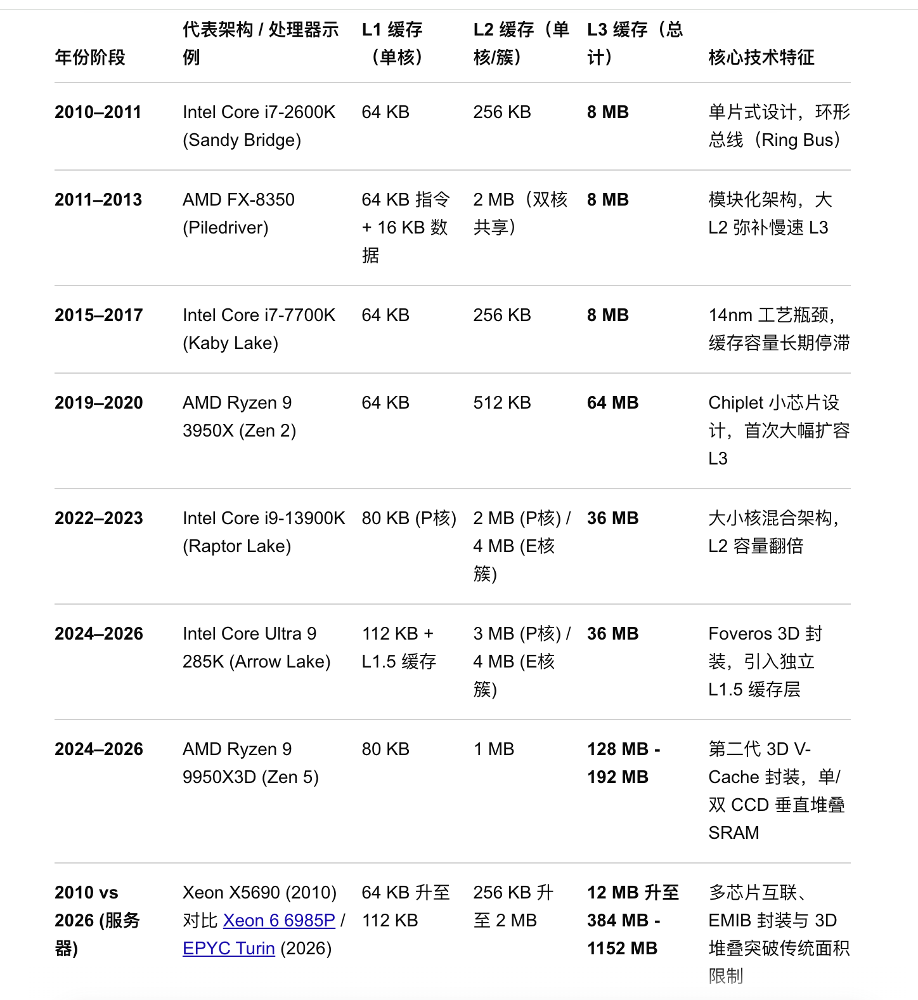
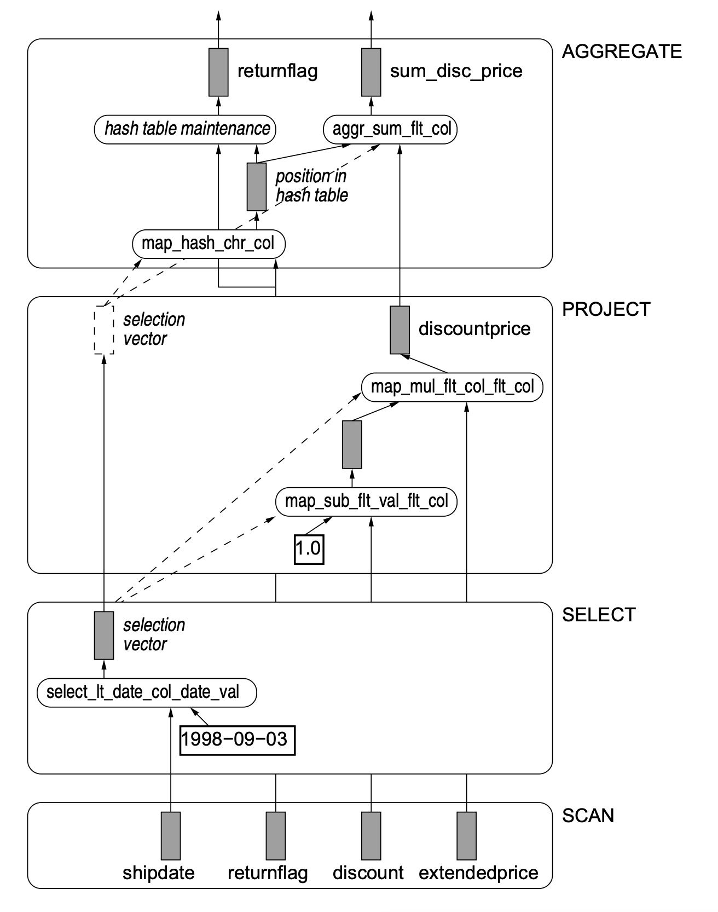
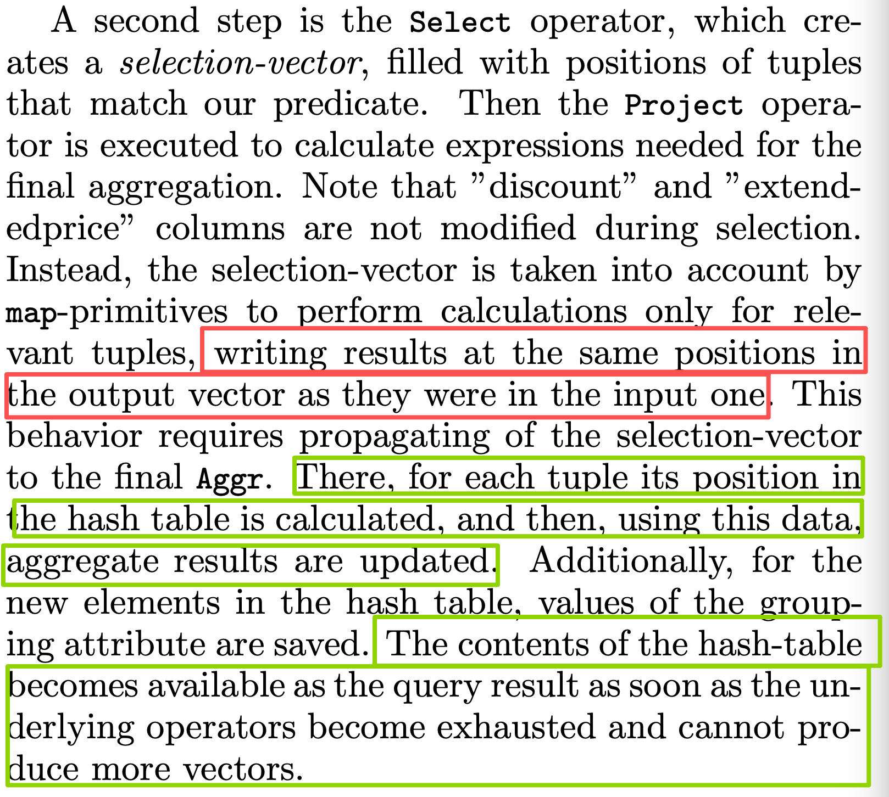
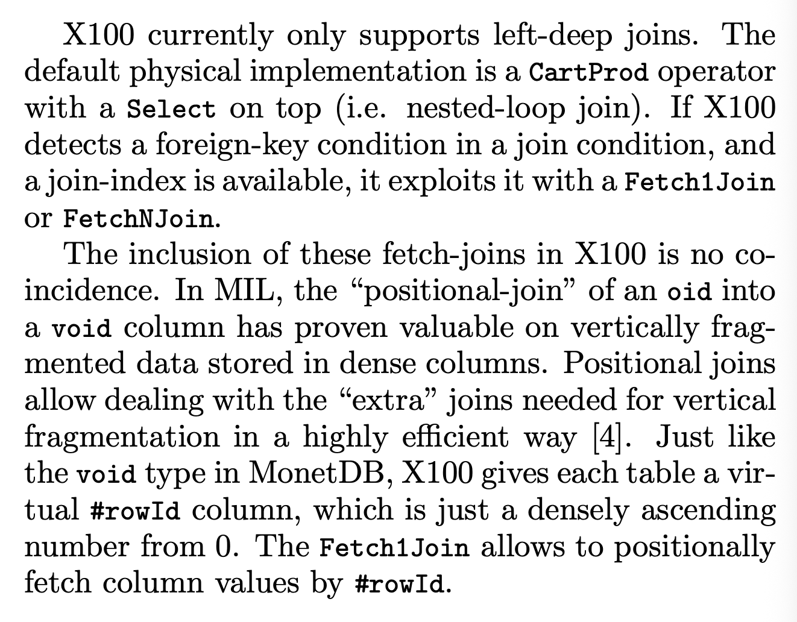
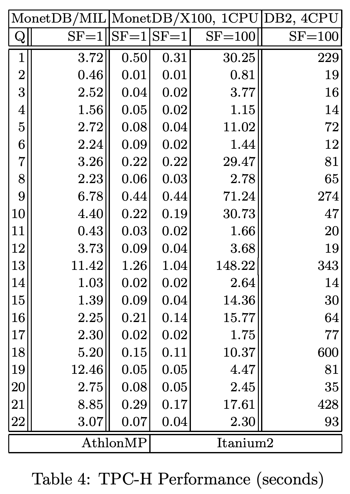

## 论文下载
MonetDB/X100: Hyper-Pipelining Query Execution [下载](https://www.cidrdb.org/cidr2005/papers/P19.pdf)<br>
年份：2005<br>
读论文的模式：半翻译 半查找资料
## TPC-H benchmark
论文是基于TPC-H做的基准测试，TPC-H模拟了一个全球性批发供应商业务系统，一共8张关系型表（customer, orders, lineitem, part, partsupp, supplier, nation, region），采用雪花架构/范式设计，数据量最大的表lineitem可达60亿数据，设计有22个复杂的即席查询。查询的性能指标主要是QphH(Composite Query-per-Hour Performance Metric)
* 论文使用数据量：on the full TPC-H benchmark of size 100GB
* TPC-H 参考文档
  * [TPC-H Benchmark](https://doris.apache.org/zh-CN/docs/3.x/benchmark/tpch)
  * [从TPC-H 看数据库查询执行的挑战：TPC-H Analyzed: Hidden Messages and Lessons Learned from an Influential Benchmark](https://zhuanlan.zhihu.com/p/635977033)
  * [TPC-C 、TPC-H、TPC-DS和SSB测试基准（Benchmark）介绍](https://blog.csdn.net/bluishglc/article/details/128191244)

## 背景
* 开篇指出了，关系性数据库，即便在处理密集查询业务时，对CPU的使用效率很低，根本原因在于传统的关系性数据库习惯了让cpu一次处理一个元组的模式（tuple-at-a-time）,使得编译器没法发掘CPU并行执行的机会
* MonetDB/MIL在执行单列运算的时候不会遇到tuple-at-a-time的问题，但是执行满列运算的时候会出现大数据流(中间数据)的现象，由于内存带宽限制导致CPU的使用效率大幅下降
* 论文为MonetDB重新设计和实现了查询引擎,命名X100。X100是基于向量化查询的查询引擎

## CPUs是怎么工作的
* 摩尔定律：1965年戈登*摩尔提出的摩尔定律，我们的cpu芯片性能或晶体管数量每两年翻一番：1.4^n（需要说明一下2026年我们处在后摩尔时代，去年华为提出了韬定律从逻辑折叠的角度驱动芯片工艺的发展）
* 现代CPU将流水线（pipeline）模式引入到指令运算中，将一个指令拆分成多个stage，经典的5级pipeline包含取指/译码/执行/访存/写回5个stage
* 按照流水线的工作流程，如果一个指令需要等待上一个指令的结果，这个指令不能立即推动到pipeline里面去，需要等到前面一个指令完成
* 流水线对于if-a-then-b-else-c需要进行分支预测，并且按照预测进行计算，但是如果前面的指令完成了最终确定分支预测错误，那么前面的计算都要被冲刷掉，并且重新计算。这种情况下pipeline越长，预测失败的惩罚越高。
* 数据库系统中，依赖数据分支的运算，最典型为select操作，当数据选择率不高不低的时候，会出现无法预测的情况，这种可能会拖慢查询速度
* 我们的CPU通常支持并行的指令计算，只要指令互相独立，就可以并行推入到不同的流水线中
* 现代CPU设计，通常会采取的不同的优化策略，Intel Itanium采用的是VLIW（超长指令字）架构，具备多条并行流水型，时钟频率较低（1.5GHZ）。Pentium4有用长达31级的流水线，时钟频率较高（3.6GHZ），但Pentium只支持3路pipeline并行。
  * 上面的是2005年的情况，2026年AMD锐龙时钟频率到了5.7HZ Intel酷睿Ultra在5.2～5.4HZ区间，流水线级数保持在14～20级
* 大部分的编程语言不要求程序员在程序中指出哪些指令是互相独立的，因此编译器优化对于实现良好的cpu利用率至关重要，其中最重要的一项级数是：循环流水线化(loop pipeline),针对数组A中所有n个独立元素所执行的，由多个互相依赖的操作
```
F(A[0]),G(A[0]),F(A[1]),G(A[1]),.. F(A[n]),G(A[n]) 
优化为：
F(A[0]),F(A[1]),F(A[2]),G(A[0]),G(A[1]),G(A[2]), F(A[3]),..
```
* 分支预测能力,将if代码转换成bool运算
```
for(int i=0,j=0; i<n; i++){
    /* branch version */
    if (src[i] < V)
    out[j++] = i;
    /* predicated version */
    bool b = (src[i] < V);
    j += b;
    out[j] = i;
    return j;
 }
```
### 关于cache，
  * 计算机存储数据读取为三级结构：硬盘（Disk）加载到内存（DARM）->CPU cache，速度如下
<style>
table {
margin: auto;
}
</style>
|读取位置/s|速度|cpu cycles|
|  ----  | ----  | ----  |
|L1|~10GB|1~4|
|L2|~10GB|10~20|
|L3|~5GB|40~75|
|内存|2~3GB|150~250|
|硬盘|40~400M|million of Cycles|

* cpu 缓存大小的发展历史

* cpu缓存命中率overwhelming时才有可能最大限度发挥cpu的吞吐能力（从内存取一次数据需要耗费50nm,180次cpu cycle(3.6GHZ)的等待）
* 内存访问开销会严重损害DBMS的性能，缓存对齐的B树和列式存储布局可以显著提升缓存命中率。查询处理算法将随机内存访问模式限制在CPU缓存所能容纳的区域内，也能大幅提升性能
* 总之CPU已经变得很复杂了，处理器的指令吞吐量有数量级的差异，影响吞吐的因子：缓存命中率、分支的数量(IF-Else)和编译后的可预测性、编译器和CPU所能识别出来的独立指令数量，商业的数据库管理系统查询执行的IPC仅0.7（矩阵运算和多媒体处理器平均为2）
  
## Microbenchmark:TPC-H Query 1
### 实验重点
主要是为了测试在查询过程中CPU的效率，所以聚焦在expression calculation(查询、聚合运算)，所以先放弃了复杂的join行为，论文基于TPC- H的query 1进行的测试。
- 数据量: 1GB，可以通过sclaing Factor(SF)对数据进行放大
- table: lineitem
- 数据对数：6M


### sql
```
SELECT l_returnflag, l_linestatus,
    sum(l_quantity) AS sum_qty,
    sum(l_extendedprice) AS sum_base_price,
    sum(l_extendedprice * (1 - l_discount))
    AS sum_disc_price,
    sum(l_extendedprice * (1 - l_discount) *
    (1 + l_tax)) AS sum_charge,
    avg(l_quantity) AS avg_qty,
    avg(l_extendedprice) AS avg_price,
    avg(l_discount) AS avg_disc,
    count(*) AS count_order
FROM lineitem
WHERE l_shipdate <= date ’1998-09-02’
GROUP BY l_returnflag, l_linestatus
```

### 火山模型（volcano）
- 也称迭代器模型，是数据库查询执行引擎的经典架构
- 核心原理
  - 算子抽象：filter/project/join/aggregation/scan,这些操作抽象为独立的算子，组合成算子树
  - 统一接口：open()/next()/close()
  - 上层算子向下层算子请求数据，下层算子每次通常返回一条元组（Tuple）供上层处理
  
### 传统关系代数的困境 
- 关系性代数对于参数通常会有很高的自由度，即便是简单的搜索查询，只有在查询发生时才会收到完整的查询信息，所以在设计的时候需要能够兼顾任意的场景
  - 这样的设计会导致核心计算所耗费的时间在实际查询过程中的占比很少（10%），另外28%用在聚合操作的哈希表的穿件和查找，剩下的62%花在了数据遍历上面，其他的像锁开销和缓冲页分配占比不大（基于mysql的分析）
  - 另外一个问题时类似于Item_func_plus:val这样的计算，每次加法使用38个指令，38/0.8=49个cycle,4个需要互相等待的指令，每个指令耗费20个cycle ,剩下的29个消耗在jumpint,push/pop stack的栈调用上
  - 大部分的关系性数据库观察到的现象和mysql类似

### MonetDB/ML
- 基本概念
  - MonetDB基于列式存储，每列对应一个binary association table(BAT),包含[oid,value]
  - 设计上几乎没有自由度，代数算子具有固定数量和固定类型的参数
    - 文中举例join(BAT[tl,te]A,BAT[te,tr]B),返回的是[tl,tr],如果需要另一头连接用reverse[A]即可
  - 复杂的表达式必须用多条语句来执行extprice*(1-tax) 可以表示成两步先执行减法，后执行乘法，每个算子总是接收若干已物化的BAT，并生成另外一个BAT
- 测试
  - 结果查询速度比传统的关系型数据库快很多
  - 问题
    - Monetdb性能被内存限制了，而非被CPU限制了
      - SF=0.01时，cpu cache的命中率很高，没有内存带宽的问题吞吐在1.5G/s，当SF=1时，吞吐被限制在500M/s
  - 原因
    - Monet的完全物化，会对于包含针对大量tuple进行复杂计算表达式的查询，系统会为每个查询物化出中间结果列。这些中间结果只是后续函数的输入，而非最终查询结果所必需。这种情况物化的数据量超过了实际的需求量，带来了极高的带宽。

### 手写代码
- 作者基于MonetDB 实现了一套硬编码的UDF代码(C)，查询时间下降到了0.22秒。这个UDF代码的性能可以看作测试的baseline
```
static void tpch_query1(int n, int hi_date,
unsigned char*__restrict__ p_returnflag,
unsigned char*__restrict__ p_linestatus,
double*__restrict__ p_quantity,
double*__restrict__ p_extendedprice,
double*__restrict__ p_discount,
double*__restrict__ p_tax,
int*__restrict__ p_shipdate,
aggr_t1*__restrict__ hashtab)
{
for(int i=0; i<n; i++) {
    if (p_shipdate[i] <= hi_date) {
        aggr_t1 *entry = hashtab +(p_returnflag[i]<<8) + p_linestatus[i];
        double discount = p_discount[i];
        double extprice = p_extendedprice[i];
        entry->count++;
        entry->sum_qty += p_quantity[i];
        entry->sum_disc += discount;
        entry->sum_base_price += extprice;
        entry->sum_disc_price += (extprice *= (1-discount));
        entry->sum_charge += extprice*(1-p_tax[i]);
}}}
```

## Monet X100: A Vectorized Query Processor
### 目标
1. 基于高cpu使用率的前提下执行大规模数据查询
2. 能够扩展到其他的应用领域包括：数据挖掘和多媒体检索
3. 能够自适应和支持最底层（磁盘）数据量的扩大

### 需要克服的计算机架构瓶颈
* DISK: X100旨在实现高效的顺序数据访问，为了降低带宽需求，采用垂直分片的数据布局，并且在某些情况辅以轻量压缩(列式存储+压缩)
* RAM: 内存里面也采用了垂直分区和压缩的磁盘布局，对内存的访问时通过显示的内存到缓存，缓存到内存的路由来执行（包含针对特定平台的优化：SSE预取指令和数据移动汇编指令）
* Cache：使用基于向量化过程的火山模型（volcano），执行原语的最小单元是vectors，vectors是规模较小（比如1000条）驻留在缓存的垂直数据块。由于缓存是唯一一个带宽，数据的压缩和解压缩操作放在内存和缓存的边界处。X100的查询处理算子需要具备“缓存”意识，能够高效地将海量数据拆分为适合缓存处理的数据块，并仅在这些数据块里执行随机访问
* CPU：向量化的原语，使得处理tuple的前后数据操作是相互对立的。对于投影（expression计算）而言是相对容易的。对于其他的类似于聚合操作，我们也视图达到同样的效果，使编译器能够生成高效的，采用循环流水线（loop-pipeline）技术的代码。为了提高CPU的吞吐（主要通过减少前文提到的指令访存操作（load/stores）,X100具备针对整个表达式编译向量化原语的能力，当前是静态引导的，未来可能会演变成由优化器在运行时动态触发。
  * 思考：论文2005年写的，当前2026年，编译向量化原语演变成优化器运行时动态触发现在到了哪个阶段，动态触发会引入什么新的问题
### Query Language
```
Aggr(
    Project(
        Select(
            Table(lineitem),
            < (shipdate, date(’1998-09-03’)
        )
    ),
    [ discountprice = *( -( flt(’1.0’), discount),
      extendedprice) ]),
    [ returnflag ],
    [ sum_disc_price = sum(discountprice) ])
```
* Execution scheme of Query 1 in MonetDB/X100

* 步骤
  * 基于Volcano-like流式计算，核心是支持以vecotor为颗粒度的计算模型
  * scan
    * 列式加载，只加载查询需要的列
    * 每次按照向量加载数据
  * selector operator
    * 按照向量维度计算符合过滤条件的数据位置（position）
    * 这个步骤不加工列数据，比如列表达式运算(加减乘除)
  * project
    * 这个步骤完成列加工，包括列与列，列与常量之间的表达式运算
  * aggregate
    * 完成最后的聚合运算
* 理解
  * 论文里面有一段话其实，我觉得不算很容易理解
  
    * 红色部分我觉得不是很容易理解，结合deepseek的问答综合描述一下自己的想法
    * [deepseek问答](https://chat.deepseek.com/share/du4awpbexzvvr809po)
  * 这一段描述其实在尝试解决
    * mysql和传统的DBMS对cpu使用效率的问题：
      * 很难简单地获取相互独立的指令，导致cpu的并行运算起不来
      * load/store和上下文切换所占用的时间远超真实运算的时间（1:9）
      * 行式取数带来的cache命中率问题（这个也是load/store的问题，括号里的描述不确定是否严谨）
    * MonetDB/MIL内存瓶颈
      * 解决前面的独立指令、cache命中、上下文运算的问题
      * 但新的问题是：产生了很多中间计算结果，这些计算结果从output->input->calculate的过程需要从内存->cpu之间进行搬运，这种情况内存的带宽成了瓶颈，一旦数据量大起来，运算的吞吐极限维持500M/s(两个型号的cpu都是如此)，考虑到这20年虽然cpu发展很快，时钟频率发展也很快，但cpu cache的指标却几乎没有变化，可能cpu和内存之间的传输速度有提升，但这个解决方案带来的瓶颈依然是瓶颈，甚至可以预见500M/s的极限不会提升太多
    * MonetDB/X100 解决方案
      * 前面图上面红色的框我不算理解，但绿色的框蛮重要的
      * 思路：将传统的DBMS解决方案和MonetDB/MIL进行了折中
        * 依然采用了Volcano的模型，从scan->selector->project->aggr一层一层迭代
          * 传统模型一次处理一条，X100一次处理一个vector(比如1000条)
            * 这样能够快速切分可独立指令提高并行度，还能提升cache命中率
            * 另外一次处理一个vector的数据，上下文切换和load/store的成本开销相当于除以约等于1000
          * Volcano模型在计算过程中每一层根据hash值迭代复用内存，比如在group运算的时候前面已经迭代完成的sum数据后面是直接复用的，不会单开新的变量.这个思路和方法能解决MonetDG/MIL产生的内存瓶颈的问题
          * 另外每一批数据是流式一步一步完成所有的运算流程，而非所有的数据先完成步骤A，再做步骤B....
### X100 Algebra
* 支持的表达式

  * Alebra
    * Table: 物化关系，DataFlow由tuples的管道流组成
    * Order/TopN/Select:输出和输入形状相同
    * Project:有时候需要执行一些运算操作(expression),但不会有任何去重的行为
    * Aggr:基于group-by列，会产生消解聚合相同数据的行为(eliminate duplicate)
    * Array: Array 算子会生成一个数据流，将 N 维数组表示为 N 元关系；该关系包含了所有有效的数组索引坐标，并按列优先（column-major）的维度顺序排列。
  * Aggregation 三种物理操作
    * 直接聚合：可用于小型数据类型（取值范围小），实现参考手工编写方案中处理的聚合方式
    * hash聚合: 除此之外参考hash聚合
    * 排序聚合: hash聚合和排序聚合的区别在于大规模数据hash聚合会导致大量的小文件，排序聚合运算量更大(参考spark的shuffle发展)
  * Join
    * 仅支持left-deep join(是否是只支持左连)
    * 连接这一段我没有太看明白，里面提到的Positional Join和Rowid,以及有效性
  

### 向量化的原语(Vectorized Primitives)
* 采用列向量布局，自由度很低，只需要了解其所操作的列，无需了解整个表的数据布局
* C编译器能够识别出X100的向量化原语是在固定且相互独立的数组上进行操作，使得编译器能够实施激进的循环流水线优化(loop-pipelining)
  * 例子:下面的Sel可以是Null也可以是select数组，包含n个被选择的position位置信息（可以理解成位置指针），X100所有的向量化原语都支持传入这一类的选择向量，优点：不需要将选中的数据复制到新的连续内存块里面去。tips:vector的数据都在cpu缓存里，随机取数的行为发生在cpu缓存里面。
```
map_plus_double_col_double_col(int n,
  double*__restrict__ res,
  double*__restrict__ col1, double*__restrict__ col2,
  int*__restrict__ sel)
{
  if (sel) {
    for(int j=0;j<n; j++) {
      int i = sel[j];
      res[i] = col1[i] + col2[i];
    }
  } else {
    for(int i=0;i<n; i++)
      res[i] = col1[i] + col2[i];
  }
}
``` 
* X100包含几百种向量化原语，这几百种向量化原语由编译时生成
  * 使用宏展开脚本，编译时根据传入的不同的数据类型生成对应的expression方法
  * 还能支持单值和数组，数组和数组，数组和单值，单值和单值的排列组合运算生成
  * 支持复合原语，且复合原语比单一功能的向量化原语快2倍：简单的二院运算运算都需要加载数据的操作（现代cpu通常在每个时钟周期内仅能执行1到2次加载存储），但复杂原语可以直接把上一次计算结果直接传递给下一步计算。

### Data Storage(存储方案)
### MonetDB/X100 采用的是垂直存储方式
* MonetDB的BAT采用的是连续的大文件存储方式
* ColumnBM会将这些文件划分为较大的数据块（>1M）
### 优点
前面大篇幅描述的是优点：支持向量化操作,需要查询哪个列加载哪个列（不需要加载全部列数据），很好的压缩性能
### 缺点
* 更新、删除、新增不方便
  * 一般将垂直分片处理成不可变的分片
  * 常见的删除方案，用额外的列表存储删除信息
  * 插入操作使用独立的增量列进行追加（将所有增量列存储在同一个数据块），相当于PAX布局（按行）
  * 定时merge增量更新（参考clickhouse的方案）
* 索引
  * 支持索引，索引内容参考clickhouse提供的方案

## TPC-H Experiment
### 实验基本内容
- TPC-H 22组query测试，SF(1/100)
- MonetDB/MIL
  - 运行环境：AthlonMP platform (1533MHz, 1GB RAM,Linux2.4) 
  - SF：1,尽量保持in-memory result，测试过程中不产生I/O
  - 数据大小：~1GB
- MonetDB/X100
  - 运行环境：Itanium2 1.3GHz (3MB cache) server with 12GB RAM running Linux2.4
  - SF：1/100
  - 数据大小：~0.8GB，可以用的字段上使用了enumeration type达到了减少数据大小的效果
- DB2
  - 运行环境：MAXDATA Platinum 9000-4R, a server machine with four 1.5GHz (6MB cache)，SCSI磁盘
- 索引
  - 同时使用外键
  - order表使用了日期排序
  - customers/spupliers两张表使用了region和country排序
- 

### Query 1性能
前面说过X100由于没有RAM bandwidth瓶颈，处理速度能达到7.5GB/s
### vector size 影响
- 最优的向量大小大概1000
- 当L1/L2/L3 cache无法容纳缓存的时候性能显著下降。
- 向量大小到了4M（400万）时，X100和MIL的性能相似
- X100的性能更好，还和他没有额外的join操作（基于流式处理，连接的时候直接使用指针指向，而非生成一层一层中间态，并且额外进行数据拷贝）

## 结尾
* 结尾讨论了下DB2的实现方法，没有细看
* 总体：X100将valcano模型、列式存储、向量化查询结合了起来，并且在实现的过程中进行了查询指令的优化，比如大部分指令支持sel参数(简化了select的上下文切换，同时通过指针的方式代替了内存拷贝)，另外通过编译脚本动态编译生成不同类型的instruction集合，限制了指令的扩展能力，也简化了process流程的逻辑。

## 感悟
1. 论文的整个实验过程很严谨，包括用hard-code的C代码作为实验的baseline，很值得学习。
2. 其实2005年的Monet X100就已经希望能兼容多媒体检索，放在现在对应上多模态的思维

## 附录
* [MonetDB/X100: a (very) fast column-store](https://www.youtube.com/watch?v=yrLd-3lnZ58)

* [Cpu设计之流水线---pipeline（深度讲解篇）](https://zhuanlan.zhihu.com/p/632266519)


